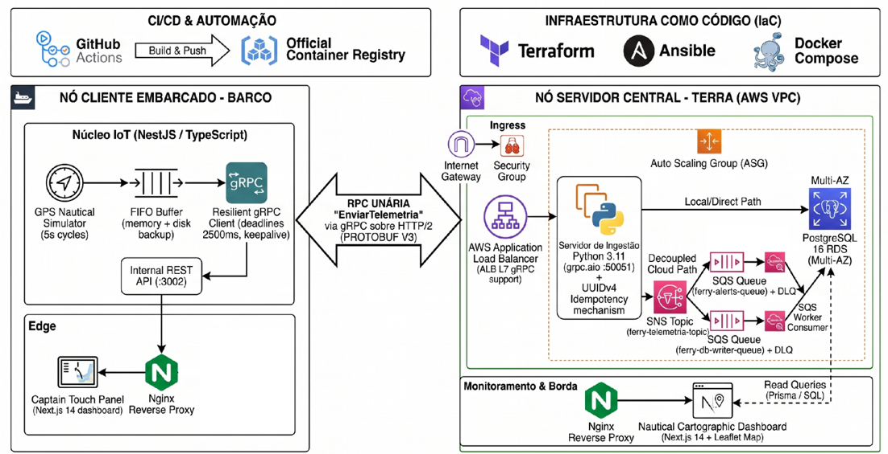

# TDE I - Sistema Distribuído de Telemetria Marítima: Ferry-Boat Salvador - Itaparica

**Disciplina:** Sistemas Distribuídos  
**Equipe:**
- Álex Lima
- Otavio Costa
- Rafael Figueiredo
- Wesley Rios

---

## 1. Ideia do Projeto

O **Sistema Distribuído de Telemetria Marítima do Ferry-Boat Salvador - Itaparica** é concebido para resolver um desafio crítico do mundo real: o monitoramento contínuo, confiável e em tempo real de embarcações marítimas durante a travessia na Baía de Todos-os-Santos (entre o Terminal de São Joaquim e o Terminal de Bom Despacho), operando em um cenário caracterizado por instabilidades severas e quedas frequentes de enlace de rede.

Em alto-mar, a perda transitória de conectividade com a infraestrutura em terra é uma premissa operacional inevitável. Em vez de descartar leituras ou bloquear os sistemas de bordo diante de falhas de comunicação, o projeto propõe a aplicação prática de conceitos fundamentais de Sistemas Distribuídos voltados à **alta disponibilidade e tolerância a particionamentos de rede** (com viés **AP** fundamentado no **Teorema CAP**).

A arquitetura proposta contempla um nó embarcado (a embarcação) equipado com um **buffer FIFO em memória** associado a um mecanismo de **persistência local em disco**. Sob condições de desconexão com a base central, o nó continuará acumulando as métricas náuticas localmente de forma segura. Assim que o canal de rádio ou conexão de rede for restabelecido, o sistema executará o descarregamento automático (*flush*) de todas as mensagens acumuladas, assegurando integridade e ausência de perda de dados.

Para otimizar a transmissão em links marítimos restritos e de baixa largura de banda com máxima segurança de borda, a comunicação entre a embarcação e a estação em terra será implementada através de **gRPC sobre HTTP/2 com criptografia e autenticação mTLS (Mutual TLS)**, utilizando **Protocol Buffers v3** como linguagem de definição de interface (IDL) e formato de serialização binária. Esta abordagem viabiliza multiplexação de chamadas em uma única conexão TCP persistente, compactação de cabeçalhos via HPACK, autenticação criptográfica mútua por certificados digitais X.509 e redução substancial da carga útil em relação a padrões REST/JSON.

O projeto visa também demonstrar **transparência de acesso poliglota**, integrando um nó cliente embarcado desenvolvido em **TypeScript (NestJS)** com um nó servidor de ingestão construído em **Python (assíncrono com grpc.aio)**. Para mitigar os impactos de retransmissões do buffer após períodos de partição, cada pacote de telemetria conterá um identificador universal único (**UUIDv4**), viabilizando garantias estritas de **idempotência** na camada de persistência em PostgreSQL.

Como módulos de apoio e validação operacional, serão concebidas duas interfaces em **Next.js 16**: o Painel do Capitão a bordo e o Dashboard Náutico da Central em terra. Toda a solução será projetada para execução conteinerizada via **Docker Compose** em ambiente de desenvolvimento e arquitetura elástica em nuvem **AWS**. Para viabilizar a absorção de picos de carga com máxima eficiência de custos e alta disponibilidade da Central, a infraestrutura implementará computação serverless elástica em contêineres via **Amazon ECS e AWS Fargate**: o provisionamento da malha elástica (VPC, Cluster ECS, tarefas Fargate com auto-scaling por demanda, Load Balancers gRPC L7, tópicos SNS, filas SQS, instância EC2 de simulação do Barco e RDS PostgreSQL 18 Single-AZ com backups contínuos no S3 e PITR) será orquestrado 100% via **Terraform**, enquanto a esteira de integração e entrega contínua (CI/CD) para build das imagens e deploy dinâmico das novas revisões de tarefas será gerenciada via **GitHub Actions** e **Amazon ECR**.

---

### 1.1. Divisão de Papéis e Responsabilidades

Para garantir a modularidade e paralelismo no desenvolvimento do sistema distribuído, as responsabilidades foram alocadas conforme as especialidades técnicas:

- **Álex Lima (Engenharia de Software Embarcado):** Modelagem do nó cliente (NestJS 12 / Node 24), geração dos stubs gRPC em TypeScript, implementação do simulador GPS, controle de deadlines/keepalive e mecanismo de retenção local (Buffer FIFO em memória + dump em disco).
- **Otavio Costa (Engenharia de Ingestão e Dados):** Concepção do nó central em Python 3.14 (grpc.aio), implementação do servicer RPC unário, pipeline de validação de schemas Protobuf v3, controle de idempotência transacional via UUIDv4 e mapeamento objeto-relacional assíncrono (SQLAlchemy 2.0 / PostgreSQL 18 com asyncpg).
- **Rafael Figueiredo (Infraestrutura em Nuvem e IaC):** Desenho da arquitetura AWS, escrita dos manifestos declarativos em Terraform ~> 1.17 (VPC, Subnets Públicas/Privadas, Security Groups encadeados, ALB L7 com suporte a gRPC, Cluster Amazon ECS com tarefas e serviços AWS Fargate, tópicos SNS, filas SQS, instância EC2 para simulação do Barco e RDS PostgreSQL 18 Single-AZ com PITR).
- **Wesley Rios (DevOps, CI/CD e Interfaces):** Automação da esteira de CI/CD via GitHub Actions (build multi-stage, push para Amazon ECR e rolling updates automatizados no ECS Fargate), orquestração local via Docker Compose, configuração dos proxies reversos Nginx e desenvolvimento dos painéis de supervisão em Next.js 16 com TailwindCSS v4 (Painel do Capitão e Dashboard Náutico com Leaflet).

---

## 2. Escopo do Projeto

### 2.1. Objetivo Geral

Projetar, implementar e validar uma malha de comunicação distribuída de alta performance, fortemente tipada, resiliente e horizontalmente escalável utilizando gRPC sobre HTTP/2, conectando nós de naturezas e linguagens distintas (TypeScript/Node.js e Python) para a transmissão contínua de telemetria de missão crítica, com capacidade de expansão elástica serverless do nó receptor em terra via Infraestrutura como Código (Terraform) e contêineres gerenciados (AWS Fargate).

### 2.2. Escopo Principal

O núcleo do projeto concentra-se estritamente na malha de comunicação distribuída, na formalização de contratos de interface e no tratamento rigoroso das garantias de chamadas remotas de procedimentos (RPC):

1. **Contrato e Definição de Interface (IDL):**
   - Definição formal e canônica de mensagens e serviços através de Protocol Buffers v3 (`proto/telemetry.proto`, pacote `ferry.telemetry.v1`).
   - Especificação de RPC unária (`TelemetryService.EnviarTelemetria`: o cliente embarcado submete um `TelemetryPacket` e recebe um `TelemetryAck` com confirmação e carimbo de data/hora do servidor).
   - Modelagem estrita e estruturada de tipos: rastreabilidade unívoca (`message_id` em `string` UUIDv4 e `boat_id`), carimbo de tempo de origem (`timestamp_coleta` em `int64`), contagem de lotação (`passageiros` em `int32`), dados de navegação (`NavigationData`: `latitude`, `longitude`, `velocidade_nos`, `rumo_graus`, `status_navegacao`), propulsão náutica (`PropulsionData`: `rpm_motor`, `temperatura_motor_celsius`, `pressao_oleo_bar`, `nivel_combustivel_percentual`, `consumo_instantaneo_lph`) e diagnóstico de rede (`NetworkDiagnostics`: `rssi_dbm`, `latencia_rtt_ms`, `perda_pacotes_percentual`, `tamanho_buffer_local`, `tentativa_envio`, `tipo_enlace`).

2. **Canal de Comunicação e Transporte (gRPC sobre HTTP/2):**
   - **Multiplexação:** Múltiplas requisições e respostas trafegando em um único socket TCP persistente.
   - **Serialização Binária:** Minimização de payload na rede em comparação com abordagens tradicionais baseadas em texto.
   - **Compactação de Cabeçalhos (HPACK):** Redução drástica do overhead em fluxos contínuos de envio periódico (intervalos de 5s).
   - **Manutenção de Sessão:** Configuração de canais assíncronos com políticas de keepalive ativas para detecção proativa de desconexão.

3. **Transparência de Acesso Poliglota:**
   - Cliente gRPC concebido em NestJS, viabilizando invocações remotas com semântica de chamada local.
   - Servidor gRPC implementado em Python utilizando o ecossistema assíncrono nativo `grpc.aio` escutando na porta 50051.
   - Propagação transparente de contexto distribuído por meio de metadados das chamadas RPC.

4. **Resiliência e Tolerância a Falhas na Camada RPC:**
   - **Deadlines Estritos:** Configuração de timeout de 2.500 ms por chamada remota, mitigando contenção de sockets e travamentos no emissor.
   - **Detecção de Quedas:** Captura e tratamento refinado de códigos de erro gRPC (e.g., `UNAVAILABLE`) pelo nó cliente para identificação imediata de interrupção do enlace náutico.
   - **Retenção e Descarregamento Controlado:** Bufferização das telemetrias retidas durante a indisponibilidade do canal e disparo sequencial regulado (*rate limit*) após reconexão.
   - **Idempotência Semântica:** Mecanismo de persistência projetado para absorver retransmissões sem duplicar registros históricos.

5. **Escalonamento Horizontal e Balanceamento gRPC (Camada 7):**
   - **Stateless Servicers:** Concepção do nó de ingestão em Python estritamente sem estado (*stateless*), desacoplando o recebimento do armazenamento (banco/filas) para permitir escalabilidade horizontal linear.
   - **Distribuição de Carga HTTP/2:** Configuração de balanceador L7 (AWS Application Load Balancer ou Nginx `grpc_pass`) para distribuir adequadamente as chamadas RPC entre os nós receptores escalados, contornando o aprisionamento de conexão por multiplexação persistente.

### 2.3. Escopo Secundário

Componentes complementares planejados para contextualizar, simular o fluxo náutico e suportar a validação visual da comunicação distribuída:

- **Simulador Embarcado de Dados Náuticos:** Módulo programático para geração progressiva de coordenadas ao longo da rota marítima Salvador – Bom Despacho a cada 5 segundos.
- **Camada de Persistência e Auditoria:** Banco de dados relacional PostgreSQL para verificação de entrega íntegra, suporte a desduplicação transacional (`ON CONFLICT DO NOTHING`) e cálculo de latência de trânsito em milissegundos.
- **Interfaces Web de Demonstração:**
  - **Painel do Barco (Porta 3000):** Ajuste de taxa de simulação, controle de lotação e acompanhamento em tempo real do estado da fila/buffer local.
  - **Dashboard da Central (Porta 3001):** Renderização cartográfica da embarcação em trânsito com base nos dados processados pelo receptor gRPC.
- **Ambiente de Execução e Nuvem:** Orquestração completa em contêineres via Docker Compose para reprodução local e planos de infraestrutura como código (Terraform) para validação elástica em tarefas AWS Fargate, EC2 dedicada para o Barco e RDS PostgreSQL 18 Single-AZ com PITR.

### 2.4. Critérios de Sucesso e Validação

| Critério | Meta de Validação |
| :--- | :--- |
| **Comunicação Poliglota** | O cliente em Node.js/NestJS deverá invocar com sucesso os procedimentos remotos gRPC expostos pelo servidor em Python, recebendo confirmações de forma consistente. |
| **Adesão ao Contrato Protobuf** | O pipeline deve rejeitar estritamente qualquer mensagem que viole os tipos, campos ou regras estabelecidas no arquivo `.proto` canônico. |
| **Resiliência a Partições** | Ao interromper intencionalmente a conectividade da Central, o nó embarcado deverá reter as coletas sem degradação do processo e descarregá-las integralmente via gRPC assim que o serviço for restabelecido. |
| **Idempotência de Entrega** | O reenvio de uma telemetria com identificador idêntico (`message_id`) deve ser reconhecido pelo servidor com flag de duplicação ativada, sem duplicação de tuplas no banco de dados. |
| **Escalabilidade Horizontal da Central** | Ao disparar o aumento de demanda ou acionar planos de contingência via métricas CloudWatch, novas tarefas serverless do nó central (`ferry-central`) no AWS Fargate deverão ser instanciadas e integradas automaticamente ao Target Group do balanceador gRPC, absorvendo o tráfego sem degradação ou perda de telemetrias. |

---

## 3. Estrutura do Projeto

A organização de diretórios planejada para o ecossistema distribuído mantém a separação canônica dos contratos, nó embarcado, nó servidor central e artefatos de infraestrutura:

```text
ferry-telemetry-tde/
├── proto/                         ---> [NÚCLEO CANÔNICO]
│   ├── telemetry.proto            ---> Contrato IDL Protobuf v3 (pacote ferry.telemetry.v1)
│   └── buf.yaml                   ---> Configuração de lint e validação sintática Buf
│
├── ferry-boat/                    ---> [NÓ CLIENTE EMBARCADO (A)]
│   ├── src/
│   │   ├── grpc/                  ---> Stubs TypeScript e cliente gRPC resiliente
│   │   │   ├── telemetry.ts       ---> Interfaces e tipos gerados via protoc
│   │   │   └── telemetry-grpc.client.ts ---> Invocações RPC, deadlines (2.500ms) e keepalive
│   │   ├── buffer/                ---> Camada de tolerância a quedas do canal gRPC
│   │   │   └── fifo-buffer.service.ts ---> Fila em memória (5.000 itens) + backup em disco
│   │   ├── simulator/             ---> Gerador da carga útil da telemetria (5s)
│   │   └── main.ts                ---> Inicialização do runtime NestJS 12 (Node 24)
│   └── frontend/                  ---> [Apoio] Painel tátil do capitão (Next.js 16)
│
├── ferry-central/                 ---> [NÓ SERVIDOR CENTRAL (B)]
│   ├── src/
│   │   ├── server/
│   │   │   ├── main.py            ---> Inicialização do servidor assíncrono grpc.aio (:50051)
│   │   │   ├── service.py         ---> Implementação do TelemetryServiceServicer
│   │   │   └── idempotency.py     ---> Validação de UUIDv4 e controle de duplicação
│   │   ├── proto/                 ---> Stubs gerados em Python (telemetry_pb2.py e telemetry_pb2_grpc.py)
│   │   └── database/              ---> Camada de persistência (SQLAlchemy 2.0 / PostgreSQL 18)
│   ├── alembic/                   ---> Configurações de migração relacional assíncrona (Alembic)
│   └── frontend/                  ---> [Apoio] Dashboard náutico com Leaflet (Next.js 16)
│
├── docker/                        ---> Configurações de proxies de borda Nginx
├── terraform/                     ---> IaC para VPC, ECS Fargate, ALB gRPC, RDS e SQS
└── docker-compose.local.yml       ---> Orquestração integrada para execução em 1 comando
```

### Execução do Nó Embarcado (SCRUM-10)

O cliente `ferry-boat` é um submódulo Git. Com Node.js 24 LTS (24.15+) e npm 11,
execute a partir da raiz deste repositório:

```powershell
git submodule update --init ferry-boat
cd ferry-boat
Copy-Item .env.example .env
npm ci
npm run start:dev
```

Em Linux/macOS, substitua `Copy-Item` por `cp`. A API interna de bordo inicia na
porta 3002 e disponibiliza `GET /health`. O setup declara os quatro módulos
fundamentais e gera os tipos a partir do contrato canônico em `proto/telemetry.proto`.
O simulador da SCRUM-13 publica amostras a cada 5s. O buffer da SCRUM-15 persiste
as coletas e conecta o envio automático ao cliente resiliente da SCRUM-14.
Consulte [o guia do nó embarcado](ferry-boat/README.md) para geração de tipos,
variáveis de ambiente, mTLS, testes e fluxo de versionamento do submódulo.

### Simulador Náutico (SCRUM-13)

O `GpsSimulatorModule` gera `telemetry.generated` independentemente da Central.
Cada amostra contém UUIDv4 em `message_id` e seu alias local `packet_id`, timestamp
e `sequence_number` incremental a partir de 1 por execução. O trajeto sintético
liga São Joaquim (-12.9482, -38.5028) a Bom Despacho (-12.9774, -38.5724), com
ida e volta, aceleração/frenagem, parada de 30s em cada terminal e ruído GPS.
As faixas de cruzeiro são 10–14 nós e 1500–1850 RPM; manobras e atracação usam
velocidade/RPM inferiores. Temperatura, HDOP, satélites, bateria e consumo de
combustível acompanham o estado do modelo.

O IDL foi estendido com campos opcionais, preservando os anteriores:
`TelemetryPacket.sequence_number` (uint64, tag 8), `NavigationData.hdop`
(double, tag 6), `NavigationData.satelites` (uint32, tag 7) e
`PropulsionData.tensao_bateria_volts` (double, tag 6). No TypeScript, sequência
e timestamps são strings; `packet_id` permanece apenas no evento local.
O modelo usa tanque cheio de 2000 L e entra em emergência se o combustível
acabar, mantendo a geração. Consulte o guia do barco para configuração e testes.
Não há calibração por dados reais. O evento é consumido pelo buffer persistente
da SCRUM-15 para retenção e envio automático.

### Cliente gRPC Resiliente (SCRUM-14)

O cliente de bordo aplica deadline gRPC de 2500ms por tentativa e keepalive de
10s, com timeout de 5s e pings habilitados sem chamadas. Apenas `UNAVAILABLE`
e `DEADLINE_EXCEEDED` recebem retries: bases de 2/4/8/16/30s, jitter de ±20%
e teto absoluto de 30s. O padrão é seis tentativas totais, configurável por
`GRPC_RETRY_MAX_ATTEMPTS` (1–10). UUID, sequência e timestamp são preservados.
No Compose, deadline e tentativas podem ser definidos no `.env` do orquestrador;
na execução direta, use o `.env` do barco.

Na primeira falha transitória, `telemetry.offline` sinaliza imediatamente o
buffer; `telemetry.delivery-settled` informa confirmação, rejeição,
falha ou cancelamento. Os retries ativos pertencem ao cliente; o buffer da
SCRUM-15 persiste a coleta e coordena o descarregamento. Consulte o guia do barco
para o contrato dos eventos, mTLS e configuração.

### Buffer FIFO Persistente (SCRUM-15)

O `BufferModule` consome o simulador, confirma a gravação em SQLite antes de
enviar e mantém apenas uma janela de até `BUFFER_MAX_ITEMS=5000` pacotes em RAM.
Os demais permanecem em disco no volume `boat-buffer`, sem descarte ao atingir
o limite de memória. Um worker executa as transações fora do loop da API.
O serviço do barco inicia independentemente da disponibilidade da Central.

A ordem de entrada do fluxo de coleta é persistida e preservada entre RAM,
disco e reinícios. Há uma RPC por vez; somente ACK aceito/duplicado do mesmo
UUID remove o primeiro item. O descarregamento espera pelo menos 20ms após
cada confirmação. Quedas transitórias retêm a cabeça da fila e retomam após
os retries do cliente; erros permanentes bloqueiam sem descartar amostras.

A API interna expõe `GET /telemetry/buffer/status` e `GET /telemetry/latest`
na porta 3002. O primeiro retorna contadores RAM/disco e estado de envio;
o segundo retorna a última coleta, inclusive após drenar/reiniciar, ou 404
enquanto não há coleta persistida. Consulte o README do barco para os campos
da API, parâmetros, formato SQLite e recuperação.

### Links dos Repositórios:
- **Repositório Principal (Orquestrador):** [https://github.com/RafaelFS01/ferry-telemetry-tde](https://github.com/RafaelFS01/ferry-telemetry-tde)
- **Nó Servidor Central:** [https://github.com/RafaelFS01/ferry-central](https://github.com/RafaelFS01/ferry-central)
- **Nó Cliente Embarcado:** [https://github.com/RafaelFS01/ferry-boat](https://github.com/RafaelFS01/ferry-boat)

### 3.1. Governança do Repositório e Estratégia de Versionamento

A colaboração e a rastreabilidade do código-fonte seguem padrões rigorosos de governança de software distribuído:

- **Estratégia de Branching (Git Flow Integrado ao Jira):**
  - `main`: Ramo estável e protegido contra push direto. Apenas código homologado entra via Pull Request aprovado.
  - `feature/SCRUM-<ID>-<kebab-case>`: Branches de funcionalidades vinculadas obrigatoriamente a uma issue do Jira (ex.: `feature/SCRUM-6-contrato-protobuf`).
  - `fix/SCRUM-<ID>-<kebab-case>`: Correções de bugs rastreadas por tickets do Jira.
  - `docs/SCRUM-<ID>-<kebab-case>`: Documentações estruturais e runbooks operacionais.
- **Política de Commits (Conventional Commits Rastreável):** Adoção estrita de Conventional Commits contendo a chave do ticket Jira no escopo, permitindo sincronização automática:
  - Formato: `<tipo>(SCRUM-<ID>): <descrição em português no imperativo>`
  - Exemplos: `feat(SCRUM-6): define mensagens e rpc unaria no protobuf`, `fix(SCRUM-15): ajusta persistencia em disco do buffer fifo`.
  - **Granularidade obrigatória nas branches:** Criar um commit por arquivo alterado ou por alteração lógica individual. Cada commit deve ter um objetivo específico e uma descrição que permita identificar a mudança e o ticket responsável; não reunir várias alterações independentes em um único commit genérico.
  - **Seleção das alterações:** Adicionar ao staging apenas o arquivo ou os trechos da alteração que será registrada. Se um arquivo contiver mudanças independentes, separá-las com `git add -p`. Conferir `git diff --cached` antes de cada commit e repetir o processo para os demais arquivos ou alterações.
- **Políticas de Integração e Revisão:**
  - Merges na `main` exigem abertura de Pull Request (PR) com o identificador do ticket no título (ex.: `[SCRUM-6] Contrato Canônico Protobuf v3`) e aprovação obrigatória de revisor (*Code Review*).
  - Execução de pipeline automatizado no GitHub Actions (CI) para linters, validação de tipos, compilação dos stubs do Protobuf e execução de testes automatizados antes do merge.

---

### 3.2. Ferramentas Oficiais e Fluxo de Trabalho Ágil (Jira + GitHub)

O ciclo de vida do projeto é gerenciado por uma esteira moderna de engenharia colaborativa e rastreabilidade bidirecional:

#### 3.2.1. Stack de Ferramentas de Gestão e Operação
| Ferramenta | Papel no Projeto | Acesso / Integração |
| :--- | :--- | :--- |
| **Jira Software (Cloud)** | Gestão ágil Scrum, backlog, estimativas, atribuição de tarefas e controle do burndown das Sprints. | Espaço: `ferry-telemetry-tde` (Key: `SCRUM`, Board: `1`) em [rafafigolif.atlassian.net](https://rafafigolif.atlassian.net) |
| **GitHub** | Repositório central de código-fonte, branches de trabalho, code review e governança. | [RafaelFS01/ferry-telemetry-tde](https://github.com/RafaelFS01/ferry-telemetry-tde) |
| **GitHub for Atlassian** | Integração oficial em nuvem entre Jira e GitHub. Associa automaticamente branches, commits e PRs às issues através da chave `SCRUM-X`. | Conectado à organização GitHub `RafaelFS01` |
| **GitHub Actions** | Automação de CI/CD: build multi-stage das imagens Docker, validação de lint/testes e rolling updates no ECS Fargate. | `.github/workflows/` |
| **Docker & Docker Compose** | Conteinerização uniforme de todos os serviços e orquestração local em 1 comando (`docker-compose.local.yml`). | Runtimes: Node 24, Python 3.14, Postgres 18, Nginx 1.27 |
| **Terraform (~> 1.17)** | Infraestrutura como Código (IaC) 100% declarativa provisionando VPC, ECS, Fargate, ALB, RDS, SNS e SQS na AWS. | `terraform/` |

#### 3.2.2. Calendário Oficial de Sprints (02 a 22 de Novembro de 2026)
O projeto possui duração de **3 semanas** com entrega e congelamento no dia **22/11/2026** e apresentação final no **Demo Day de 23/11/2026**:
- **Sprint 1 (02/11 a 06/11/2026) — Fundação, Contratos IDL e Infraestrutura Base:** Definição do Protobuf v3, IaC da VPC/RDS/Cluster, Docker Compose local e setups dos runtimes NestJS e Python grpc.aio.
- **Sprint 2 (07/11 a 12/11/2026) — Comunicação gRPC Resiliente e Ingestão com Idempotência:** Simulador GPS náutico, cliente gRPC com deadlines/keepalive, buffer FIFO offline com dump em disco e persistência assíncrona com Alembic.
- **Sprint 3 (13/11 a 18/11/2026) — Desacoplamento Assíncrono e Interfaces Web:** Broker SNS/SQS com DLQ, worker consumidor em lote, painéis Next.js 16 (Capitão e Central com Leaflet) e IaC do Fargate/ALB.
- **Sprint 4 (19/11 a 22/11/2026) — CI/CD, Testes de Resiliência E2E e Homologação:** Pipeline GitHub Actions, simulação de partição de 24h (17.280 pacotes), testes de carga, deploy final na AWS e runbooks operacionais.
- **Demo Day (23/11/2026):** Apresentação acadêmica e demonstração ao vivo da resiliência do sistema distribuído.

#### 3.2.3. Fluxo de Trabalho Integrado (Passo a Passo do Desenvolvedor)
Para garantir que o app **GitHub for Atlassian** vincule os artefatos de código às tarefas do Jira em tempo real, cada membro da equipe deve seguir estritamente o fluxo:
1. **Identificar a Tarefa no Jira:** Acesse o board do Jira e verifique a issue atribuída a você (ex.: `SCRUM-6`).
2. **Criar a Branch a partir da `main`:** Execute o comando canônico descrito no topo da própria tarefa do Jira:
   ```bash
   git checkout main
   git pull origin main
   git checkout -b feature/SCRUM-<ID>-<nome-da-tarefa>
   ```
3. **Desenvolver e Testar Localmente:** Implemente as alterações e rode os testes e validações estáticas via Docker Compose.
4. **Comitar por Arquivo ou Alteração com Referência ao Jira:**
   ```bash
   git add -- caminho/do/arquivo
   git diff --cached
   git commit -m "feat(SCRUM-<ID>): implementa alteracao especifica do arquivo"
   ```
   Repita para cada arquivo ou alteração lógica individual. Para registrar apenas parte de um arquivo, use `git add -p -- caminho/do/arquivo`. Evite `git add .` quando houver várias alterações independentes, preservando a rastreabilidade de cada mudança na branch.
5. **Enviar a Branch e Abrir Pull Request:**
   ```bash
   git push -u origin feature/SCRUM-<ID>-<nome-da-tarefa>
   ```
   No GitHub, abra o PR com o título iniciando por `[SCRUM-<ID>]`. O Jira atualizará o status do desenvolvimento imediatamente.
6. **Code Review e Merge:** Após aprovação do revisor e aprovação no CI do GitHub Actions, o PR é mesclado na `main`.

#### 3.2.4. Catálogo Canônico de Tarefas Jira e Branches Homologadas
Todas as 23 tarefas cadastradas no Jira possuem suas respectivas branches padronizadas:

| Chave Jira | Tarefa / Entregável | Sprint | Responsável | Branch Recomendada | Comando Git de Partida |
| :--- | :--- | :---: | :--- | :--- | :--- |
| **SCRUM-6** | Contrato Canônico Protobuf v3 e RPC EnviarTelemetria | S1 | Otavio Costa | `feature/SCRUM-6-contrato-protobuf` | `git checkout -b feature/SCRUM-6-contrato-protobuf` |
| **SCRUM-7** | Módulo Terraform: VPC, Subnets e Security Groups | S1 | Rafael Figueiredo | `feature/SCRUM-7-terraform-vpc-subnets` | `git checkout -b feature/SCRUM-7-terraform-vpc-subnets` |
| **SCRUM-8** | Módulo Terraform: RDS PostgreSQL 18 Single-AZ | S1 | Rafael Figueiredo | `feature/SCRUM-8-terraform-rds-postgres` | `git checkout -b feature/SCRUM-8-terraform-rds-postgres` |
| **SCRUM-9** | Modelagem Relacional e Migrações Alembic | S1 | Otavio Costa | `feature/SCRUM-9-sqlalchemy-migrations` | `git checkout -b feature/SCRUM-9-sqlalchemy-migrations` |
| **SCRUM-10** | Setup do Nó Barco (NestJS 12 / Node 24) | S1 | Álex Lima | `feature/SCRUM-10-setup-barco-nestjs` | `git checkout -b feature/SCRUM-10-setup-barco-nestjs` |
| **SCRUM-11** | Orquestração Local Integrada (Docker Compose) | S1 | Rafael Figueiredo | `feature/SCRUM-11-docker-compose-local` | `git checkout -b feature/SCRUM-11-docker-compose-local` |
| **SCRUM-12** | Servidor gRPC Assíncrono (Python grpc.aio) | S1 | Otavio Costa | `feature/SCRUM-12-servidor-grpc-python` | `git checkout -b feature/SCRUM-12-servidor-grpc-python` |
| **SCRUM-13** | Simulador GPS Náutico Salvador-Itaparica | S2 | Otavio Costa | `feature/SCRUM-13-simulador-gps-nautico` | `git checkout -b feature/SCRUM-13-simulador-gps-nautico` |
| **SCRUM-14** | Cliente gRPC Resiliente (Deadlines e Keepalive) | S2 | Álex Lima | `feature/SCRUM-14-cliente-grpc-resiliente` | `git checkout -b feature/SCRUM-14-cliente-grpc-resiliente` |
| **SCRUM-15** | Buffer FIFO em Memória com Backup em Disco | S2 | Álex Lima | `feature/SCRUM-15-buffer-fifo-offline` | `git checkout -b feature/SCRUM-15-buffer-fifo-offline` |
| **SCRUM-16** | Módulo Terraform: Tópico SNS e Filas SQS + DLQ | S3 | Rafael Figueiredo | `feature/SCRUM-16-terraform-sns-sqs-dlq` | `git checkout -b feature/SCRUM-16-terraform-sns-sqs-dlq` |
| **SCRUM-17** | Worker Consumidor SQS e Escrita em Lote (Batch) | S3 | Otavio Costa | `feature/SCRUM-17-worker-sqs-ingestao` | `git checkout -b feature/SCRUM-17-worker-sqs-ingestao` |
| **SCRUM-18** | Módulo Terraform: ECS Cluster, Fargate e ALB | S3 | Rafael Figueiredo | `feature/SCRUM-18-terraform-ecs-fargate-alb` | `git checkout -b feature/SCRUM-18-terraform-ecs-fargate-alb` |
| **SCRUM-19** | Módulo Terraform: Instância EC2 Barco (Ubuntu 24.04)| S3 | Rafael Figueiredo | `feature/SCRUM-19-terraform-ec2-barco` | `git checkout -b feature/SCRUM-19-terraform-ec2-barco` |
| **SCRUM-20** | Proxies Nginx Conteinerizados (Rate Limiting/Borda)| S3 | Rafael Figueiredo | `feature/SCRUM-20-nginx-reverse-proxy` | `git checkout -b feature/SCRUM-20-nginx-reverse-proxy` |
| **SCRUM-21** | Painel Tátil do Capitão (Next.js 16 / Tailwind v4) | S3 | Wesley Rios | `feature/SCRUM-21-painel-capitao-nextjs` | `git checkout -b feature/SCRUM-21-painel-capitao-nextjs` |
| **SCRUM-22** | API REST Interna da Central para Consulta | S3 | Otavio Costa | `feature/SCRUM-22-api-rest-central` | `git checkout -b feature/SCRUM-22-api-rest-central` |
| **SCRUM-23** | Dashboard Cartográfico Náutico com Leaflet | S3 | Wesley Rios | `feature/SCRUM-23-dashboard-central-leaflet` | `git checkout -b feature/SCRUM-23-dashboard-central-leaflet` |
| **SCRUM-24** | Pipeline CI/CD com GitHub Actions e Amazon ECR | S4 | Wesley Rios | `feature/SCRUM-24-ci-cd-github-actions` | `git checkout -b feature/SCRUM-24-ci-cd-github-actions` |
| **SCRUM-25** | Suíte de Testes Automatizados (Pytest e Jest) | S4 | Otavio Costa | `feature/SCRUM-25-testes-pytest-grpc` | `git checkout -b feature/SCRUM-25-testes-pytest-grpc` |
| **SCRUM-26** | Teste de Partição de Rede de 24h (17.280 pacotes)| S4 | Álex Lima | `feature/SCRUM-26-teste-particao-rede-24h` | `git checkout -b feature/SCRUM-26-teste-particao-rede-24h` |
| **SCRUM-27** | Deploy e Validação End-to-End na Nuvem AWS | S4 | Rafael Figueiredo | `feature/SCRUM-27-deploy-aws-e2e` | `git checkout -b feature/SCRUM-27-deploy-aws-e2e` |
| **SCRUM-28** | Documentação Final, Runbooks e Apresentação | S4 | Equipe | `docs/SCRUM-28-runbooks-apresentacao` | `git checkout -b docs/SCRUM-28-runbooks-apresentacao` |

---

## 4. Planejamento do Projeto

O cronograma de implementação técnica está estruturado em fases sequenciais de engenharia de software distribuído:

### Fase 1: Concepção do Contrato e Especificação IDL
- **Objetivo:** Definição da interface formal e validação do domínio distribuído.
- **Tarefas a Executar:**
  - Criação do arquivo canônico `proto/telemetry.proto` (pacote `ferry.telemetry.v1`) com tipagem estrita para telemetria náutica (`TelemetryPacket` com dados de navegação, propulsão náutica, diagnóstico de rede, lotação, timestamps em epoch e identificador UUIDv4, e resposta `TelemetryAck` no serviço `TelemetryService`).
  - Validação sintática limpa e lint com `protoc` / `buf` (`proto/buf.yaml`).
  - Automação de compilação dos stubs via `protoc` / `grpc_tools` para os ecossistemas TypeScript e Python.
  - Implementação de suíte de testes de invariantes para validação de compatibilidade binária entre os compiladores.

### Fase 2: Implementação do Servidor de Ingestão gRPC (Python)
- **Objetivo:** Construção do nó receptor de alto throughput na Central em terra.
- **Tarefas a Executar:**
  - Implementação de servidor assíncrono via `grpc.aio.server()` para suportar alta concorrência nativa.
  - Implementação da RPC unária `EnviarTelemetria`, incluindo validação sintática do payload e extração de metadados da sessão.
  - Construção do mecanismo de desduplicação transacional e idempotência com base na chave `message_id`.
  - Configuração de rotina de *graceful shutdown* (drenagem controlada de conexões) e suporte ao protocolo oficial de gRPC Health Checking.

### Fase 3: Implementação do Cliente gRPC Resiliente (NestJS)
- **Objetivo:** Garantia de transparência de chamada e robustez do nó embarcado contra falhas de enlace.
- **Tarefas a Executar:**
  - Instanciação de canal gRPC configurado com políticas de keepalive ativo (pings periódicos na camada de transporte).
  - Definição de Deadlines rígidos de 2.500 ms para prevenir esgotamento de sockets em situações de degradação da rota.
  - Arquitetura de contingência: interceptor para captura de status `UNAVAILABLE` e redirecionamento de amostras para o buffer FIFO em memória com dump em disco.
  - Mecanismo de descarregamento sequencial pós-reconexão com controle de fluxo (delay de 20ms por mensagem enviada).

### Fase 4: Testes de Resiliência e Cenários de Falha de Rede
- **Objetivo:** Validação empírica dos requisitos de tolerância a falhas na camada gRPC.
- **Cenários Planejados:**
  - **Cenário A (Queda Abrupta do Servidor):** Interrupção forçada da Central com emissão contínua no Barco para validar a integridade do acúmulo no buffer local.
  - **Cenário B (Recuperação do Link):** Restabelecimento do canal da Central para checagem do esvaziamento completo da fila sem perda de registros.
  - **Cenário C (Estresse de Idempotência):** Injeção proposital de chamadas com mesmo `message_id` para validar a resposta `duplicado = true` e ausência de efeitos colaterais na base.
  - **Cenário D (Latência e Overhead):** Medição da latência de trânsito fim a fim no banco de dados e comparação de consumo de banda frente ao padrão REST/JSON.

### Fase 5: Integração dos Módulos de Apoio e Orquestração
- **Objetivo:** Construção das camadas visuais e infraestrutura de suporte à demonstração.
- **Tarefas a Executar:**
  - Desenvolvimento das interfaces em Next.js 16 (Painel de Bordo do Capitão e Dashboard Náutico com Leaflet).
  - Orquestração integrada de contêineres via Docker Compose em malha unificada de rede.
  - Provisionamento da Malha Elástica com Terraform: Módulos para criação de VPC, Subnets, Target Groups gRPC, Application Load Balancer (ALB), Cluster Amazon ECS com tarefas AWS Fargate, tópicos SNS, filas SQS, EC2 do Barco e banco RDS PostgreSQL 18 Single-AZ com PITR.
  - Automação de CI/CD com GitHub Actions: Workflows automatizados para compilação multi-stage, push para Amazon ECR e deploy contínuo (rolling updates) das tarefas no AWS Fargate com verificação de probes gRPC Health Checking.
  - Teste de Carga e Escala: Simulação de adição dinâmica de nós centrais durante envio contínuo de telemetria, atestando o balanceamento transparente das requisições.

---

## 5. System Design do Projeto

A arquitetura de System Design do projeto organiza-se em dois macroambientes: o **Nó Cliente Embarcado (Instância A - Barco)** e o **Nó Servidor Central (Instância B - Central de Terra)**, conectados pelo canal de telemetria gRPC sobre HTTP/2.



### 5.1. Nó Cliente Embarcado (Instância A - Barco)

- **Núcleo IoT Embarcado (NestJS):**
  - **Simulador Náutico GPS:** Gera periodicamente (ciclos de 5s) a trajetória Salvador ↔ Itaparica.
  - **Camada de Tolerância a Falhas (CAP / AP):** Buffer FIFO com janela RAM de até 5.000 amostras e persistência SQLite em disco (`telemetry-buffer.sqlite`), preservando a fila em reinícios sem descartar o excedente do cache.
  - **REST API Control & Status (Porta 3002):** Interface interna para fornecimento de métricas locais e estado do nó para a camada visual.
  - **Cliente gRPC Resiliente:** Responsável pela invocação RPC, controle de deadline (2.500 ms), keepalive e propagação de Correlation ID.
- **Apresentação & Borda:**
  - **Borda Reversa Nginx (Porta 80 / 8080):** Rate limiting e hardening de rede.
  - **Painel Tátil do Capitão (Next.js 16 Standalone na Porta 3000):** Controle de lotação, visualização da taxa de envio e estado da fila.

### 5.2. Canal de Comunicação Distribuída

- **RPC Unária `TelemetryService/EnviarTelemetria`:** Executada sobre HTTP/2 com criptografia e autenticação mútua via **mTLS (Mutual TLS)** e Protocol Buffers v3 (`ferry.telemetry.v1`), transportando o `TelemetryPacket` (`message_id` UUIDv4, `boat_id`, `timestamp_coleta`, `passageiros`, `NavigationData`, `PropulsionData` e `NetworkDiagnostics`) e retornando o `TelemetryAck` com confirmação de entrega e carimbo de data/hora do servidor (`processado_em`).

### 5.3. Nó Servidor Central (Instância B - Central de Terra)

- **Servidor de Ingestão (Python 3.14):**
  - **Servidor gRPC Assíncrono (grpc.aio na Porta 50051):** Recepção de alto desempenho, validação de schema e verificação de integridade.
  - **Mecanismo de Idempotência:** Controle estrito de duplicidade baseado na chave primária UUIDv4 com política `ON CONFLICT DO NOTHING`.
- **Roteamento e Persistência:**
  - **Modo Direto / Local:** Conexão direta via pool TCP assíncrono (porta 5432) com SQLAlchemy 2.0 / asyncpg para persistência no PostgreSQL 18.
  - **Modo Nuvem Desacoplado (Mensageria Serverless AWS):** Publicação em tópico SNS (`ferry-telemetria-topic`) com fan-out para filas SQS (`ferry-db-writer-queue` para persistência em lote e `ferry-alerts-queue` para detecção de anomalias/lotação), contando com Dead Letter Queue (DLQ) com retenção de 14 dias e consumidor assíncrono.
  - **Base de Dados Relacional:** PostgreSQL 18 contendo a tabela `telemetrias` com chave primária `message_id` e campo gerado computado `latencia_transito_ms` (`STORED`).
- **Monitoramento Cartográfico:**
  - **Borda Reversa Nginx (Porta 80 / 8081):** Headers de segurança e proxy HTTP.
  - **Dashboard Cartográfico Náutico (Next.js 16 Standalone na Porta 3001):** Visualização espacial da rota em tempo real via Leaflet, OpenStreetMap e gráficos Recharts alimentados por API REST interna da Central.
- **Arquitetura de Escalonamento Horizontal (Nó Central):**
  - **Pool de Ingestão Elástico Serverless:** Tarefas elásticas no Amazon ECS com AWS Fargate executando o serviço `ferry-central` em Python 3.14 (`grpc.aio`), escalando sob demanda sem necessidade de instâncias EC2 subjacentes.
  - **Balanceamento L7 gRPC:** Ingress / ALB distribuindo streams HTTP/2 por algoritmo round-robin ou least-outstanding-requests diretamente aos nós de ingestão saudáveis.
  - **Provisionamento e Orquestração Serverless (Terraform + ECS Fargate + GitHub Actions):**
    - **Terraform:** Gerencia 100% da infraestrutura declarativa (criação do Cluster ECS, Task Definitions, ECS Services, Application Load Balancers, tópicos SNS, filas SQS e banco RDS).
    - **AWS Fargate + CloudWatch:** Orquestra o auto-scaling dinâmico dos contêineres: a ingestão gRPC escala por CPU/conexões e os workers de banco escalam instantaneamente pelo volume de mensagens na fila SQS (`ApproximateNumberOfMessagesVisible`), esvaziando rajadas de 24h sem servidores ociosos.
    - **GitHub Actions + Amazon ECR:** Executa a esteira automatizada de build, push de imagens versionadas e rolling update transparente das tarefas no ECS Fargate.
  - **Consistência em Múltiplos Nós:** Como múltiplas instâncias da central podem receber pacotes retransmitidos simultaneamente pelo buffer do barco, a idempotência transacional (`ON CONFLICT (message_id) DO NOTHING` no PostgreSQL) garante a integridade dos dados independente de qual nó processe a requisição.

---

## 6. Segurança do Projeto

O planejamento técnico de como cada aspecto de segurança será projetado e implementado na versão final do sistema:

- **Autenticação e Autorização:**
  O canal de telemetria gRPC adotará autenticação mútua e criptografia de ponta a ponta via **mTLS (Mutual TLS)** sobre HTTP/2. O nó embarcado (`ferry-boat`) possuirá um certificado digital de cliente X.509 assinado pela Autoridade Certificadora (CA) do projeto, e o servidor de ingestão (na borda com o ALB / Central) validará a autenticidade e integridade desse certificado a cada conexão. Embora o handshake criptográfico inicial do TLS introduza um custo leve de latência no momento da abertura do socket TCP, a persistência e a multiplexação de streams do HTTP/2 amortizam completamente essa sobrecarga ao longo de toda a travessia náutica, mantendo o canal aberto e performático. Essa estratégia estabelece uma postura de segurança *Zero Trust*, tornando o sistema imune aos riscos de IPs dinâmicos das operadoras móveis em alto-mar. Os painéis web em Next.js 16 e a API interna do simulador operarão protegidos por proxies Nginx. Na Central, com a adoção do AWS Fargate Serverless, elimina-se completamente a superfície de ataque por SSH (porta 22 fechada na nuvem), e as credenciais de acesso ao PostgreSQL são isoladas estritamente na VPC privada.
- **Gestão de Segredos e Tokens:**
  Seguirá as boas práticas de segurança em desenvolvimento de software para prevenir o vazamento de credenciais. Nenhuma senha, chave privada ou arquivo local de ambiente (`.env`) será versionado no repositório Git, sendo blindados no `.gitignore`. Na automação com Terraform, as variáveis sensíveis, como a senha de administração do RDS, serão demarcadas com o atributo `sensitive`, suprimindo sua exibição em logs de terminal e planos de execução. No ambiente de produção e na integração contínua (CI/CD), a injeção de parâmetros sensíveis (chaves SSH, strings de conexão ao banco e tokens do Docker Hub) ocorrerá dinamicamente em tempo de execução via GitHub Actions Secrets.
- **Proteção de Borda:**
  Será projetada através da inclusão de proxies reversos Nginx atuando à frente dos módulos frontend em ambos os nós da arquitetura. O Nginx será configurado para mascarar a assinatura do servidor, aplicar políticas ativas de limitação de taxa (*Rate Limiting* e resposta HTTP 429 para amortecer potenciais ataques de negação de serviço) e injetar cabeçalhos HTTP de proteção estrita, incluindo Content-Security-Policy, prevenção contra Clickjacking e bloqueio de inferência de tipo.
- **Regras de Firewall:**
  Serão estruturadas por meio de AWS Security Groups interdependentes. Apenas o tráfego HTTP/HTTPS e gRPC seguro (portas 80, 443 e 50051) estará exposto publicamente via Application Load Balancer. Como a Central roda em AWS Fargate Serverless, não há porta SSH (22) exposta na nuvem. A porta do serviço gRPC na Central aceitará conexões autenticadas estritamente via handshake mTLS (rejeitando sumariamente qualquer cliente sem o certificado válido da embarcação), mantendo as tarefas internas e a porta do PostgreSQL no RDS completamente inacessíveis da internet pública, aceitando conexões exclusivamente provenientes dos Security Groups autorizados do ECS/ALB.
- **Segmentação de Rede:**
  Toda a infraestrutura em nuvem será isolada em uma Virtual Private Cloud (VPC). As instâncias computacionais (Barco e Central) serão alocadas em subnets públicas com rotas de saída via Internet Gateway para viabilizar os acessos web e rotinas de manutenção SSH. A base de dados relacional (RDS) residirá em subnets privadas sem rotas de saída para a internet, tornando o banco inacessível fora dos limites internos da VPC. No nível do sistema operacional, cada host executará seus contêineres confinados em redes Docker (`barco-net` e `central-net`), garantindo a contenção do tráfego local entre os serviços.

---

## 7. Resolução de Nome, Mapeamento de Domínios e Roteamento de Tráfego

A topologia de resolução de nomes e direcionamento de tráfego fornece desacoplamento total entre os endereços IP efêmeros das instâncias computacionais (AWS EC2) e a lógica de comunicação dos serviços distribuídos. Essa camada garante que a reinicialização de instâncias, expansões por Auto Scaling ou migrações de zona não interfiram na continuidade da telemetria náutica.

### 7.1. Arquitetura de Resolução DNS com AWS Route 53

O ecossistema utiliza o AWS Route 53 dividido em duas Zonas de Hospedagem (*Hosted Zones*) com responsabilidades distintas:

1. **Zona Pública de Borda (Externa):**
   - `telemetry.rioswesley.com.br`: Registro do tipo A (Alias) apontando diretamente para o endpoint canônico do AWS Application Load Balancer (ALB). Este é o alvo estático configurado no cliente gRPC do Nó Barco para o envio de RPCs unárias.
   - `painel.rioswesley.com.br`: Registro do tipo CNAME apontando para a distribuição do painel web de supervisão náutica da Central em terra.
   - `capitao.rioswesley.com.br`: Registro do tipo A resolvido localmente no gateway do porto ou IP dinâmico da embarcação para acesso ao painel de bordo.

2. **Zona Privada da VPC (AWS Route 53 Private Hosted Zone):**
   - **Domínio Interno:** `ferry.internal` (isolado estritamente dentro da VPC).
   - `db.ferry.internal`: Registro do tipo CNAME mapeando o endpoint primário da instância PostgreSQL 18 no Amazon RDS Single-AZ com PITR. As tarefas do pool de ingestão e os workers de mensageria utilizam exclusivamente esse FQDN para inicialização do pool de conexões TCP, mantendo as credenciais desacopladas de endereços IP mutáveis.
   - `events.ferry.internal`: Registro interno via AWS PrivateLink/VPC Endpoints para comunicação direta e privada das instâncias com os tópicos SNS e filas SQS, prevenindo que o tráfego interno trafegue pelo Internet Gateway.

### 7.2. Resolução no Ambiente Local (Docker Compose)

Para paridade em ambiente de desenvolvimento local, a resolução de nomes opera por meio do DNS interno embarcado do Docker (*Docker Embedded DNS* na porta 127.0.0.11), onde os nomes de serviços canônicos (`ferry-central`, `postgres`, `ferry-boat`) são mapeados dinamicamente em redes bridge dedicadas (`barco-net` e `central-net`).

### 7.3. Roteamento Especializado e Distribuição de Carga HTTP/2

O balanceamento de tráfego é tratado na Camada 7 (Aplicação) para mitigar o gargalo clássico de aprisionamento de conexões persistentes em HTTP/2:

- **Roteamento gRPC L7 (AWS ALB):** O balanceador é provisionado com Target Groups configurados explicitamente com o protocolo de versão gRPC. Essa configuração viabiliza que o balanceador abra as conexões HTTP/2 multiplexadas vindas do barco e distribua individualmente cada chamada RPC remota entre as diferentes réplicas ativas no Auto Scaling Group (ASG) utilizando o algoritmo de balanceamento *least outstanding requests*.
- **Proxy de Borda Nginx:** Atua na terminação de tráfego web convencional (HTTP/1.1), aplicando regras de roteamento baseadas em cabeçalhos e paths para servir a aplicação Next.js e proteger as interfaces de monitoramento e supervisão web.
